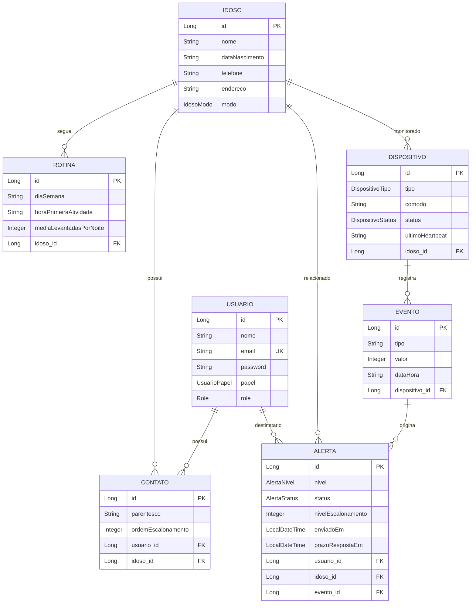

# Tô Bem API

API REST para monitoramento de idosos por dispositivos, registro de rotinas e eventos e acompanhamento de alertas. Desenvolvida em Java com Spring Boot para o projeto Global Solution 2026/2 — FIAP, turma 2TDSPS.

## Integrantes e pitch

- Matheus Guimarães Rosa — rm567912.
- Lucas Shida Rodrigues da Costa — rm568194.
- Pedro Henrique Pinheiro Falchi — rm566967
- Pitch: **inserir link público do vídeo de até 5 minutos**.
- Repositório: https://github.com/To-Bem/JAVA

## Tecnologias

Java 21, Maven, Spring Boot 4.1.2, Spring Web MVC, Spring Data JPA, H2, Bean Validation, Spring Security, JWT/JJWT, Spring Boot Actuator e Springdoc OpenAPI. O banco local é H2 em arquivo; os testes usam H2 em memória.

## Como executar

Requisitos: JDK 21 e Maven 3.9+. Execute os comandos na raiz deste repositório. A primeira execução precisa de acesso à internet para baixar dependências.

No PowerShell, defina as variáveis da sessão:

```powershell
$jwtBytes = New-Object byte[] 32
$rng = [System.Security.Cryptography.RandomNumberGenerator]::Create()
$rng.GetBytes($jwtBytes)
$rng.Dispose()
$env:JWT_SECRET = [Convert]::ToBase64String($jwtBytes)
$env:ADMIN_EMAIL = 'admin@example.com'
$env:ADMIN_PASSWORD = 'AdminTeste12345!'
mvn spring-boot:run
```

`JWT_SECRET` deve conter uma chave Base64 com pelo menos 32 bytes. Preserve a mesma chave entre reinicializações se quiser manter válidos os tokens já emitidos. As credenciais acima são exemplos locais: defina outras ao publicar. O primeiro administrador é criado automaticamente se o email configurado ainda não existir. O inicializador não altera usuários já existentes.

Também é possível executar `mvnw.cmd spring-boot:run` no Windows se não houver Maven instalado. Configure as mesmas três variáveis no IntelliJ caso execute pela IDE; Spring Boot não carrega `.env` automaticamente nesta configuração.

| Recurso | URL local |
|---|---|
| API | http://localhost:8080/api |
| Swagger UI | http://localhost:8080/swagger-ui/index.html |
| OpenAPI JSON | http://localhost:8080/v3/api-docs |
| Health | http://localhost:8080/actuator/health |
| Info | http://localhost:8080/actuator/info |
| Metrics | http://localhost:8080/actuator/metrics |
| Console H2, para desenvolvimento | http://localhost:8080/h2-console |

No console H2: URL JDBC `jdbc:h2:file:./data/toBemApi`, usuário `sa` e senha vazia. O arquivo local fica em `data/`. Não abra duas instâncias da API usando o mesmo arquivo. Recriar esse banco é uma ação manual e apaga seus dados; a aplicação usa `ddl-auto: update`.

## Autenticação e usuários de teste

`POST /api/auth/register` cadastra MEMBER. `POST /api/auth/login` recebe email e password e retorna o JWT. Nas chamadas protegidas envie `Authorization: Bearer <token>`. No Swagger, use **Authorize** e informe somente o token.

```json
{
  "email": "admin@example.com",
  "password": "AdminTeste12345!"
}
```

Para preparar usuários de demonstração, com a API rodando e as variáveis do administrador configuradas em outra sessão PowerShell:

```powershell
./scripts/popular-usuarios-teste.ps1
```

| Role | Email | Senha local de exemplo | Criação |
|---|---|---|---|
| ADMIN | Valor de `ADMIN_EMAIL` (exemplo: admin@example.com) | Valor de `ADMIN_PASSWORD` | Inicializador |
| MANAGER | gerente.teste@example.com | Teste12345! | Script ou cadastro privilegiado |
| MEMBER | familiar.teste@example.com | Teste12345! | Script ou cadastro público |

O script não é executado automaticamente e não remove registros. Se o email já existir, ele mantém o cadastro e a senha anteriores.

## Permissões

| Operações | Acesso |
|---|---|
| Cadastro público e login | Sem token |
| Health resumido e Swagger | Sem token |
| Listagens gerais `findAll`, Actuator info/metrics | ADMIN ou MANAGER |
| Criar ADMIN/MANAGER | Somente ADMIN |
| Consultar conta e relacionamentos do usuário | ADMIN/MANAGER ou o próprio usuário |
| Atualizar/excluir conta | ADMIN ou o próprio usuário |
| Cadastrar idoso para um usuário | ADMIN/MANAGER ou o próprio usuário |
| Consultar idoso, dispositivo, evento, rotina, contato e alerta | ADMIN/MANAGER ou MEMBER vinculado ao idoso por Contato |
| Filtros de alertas, contatos, dispositivos e eventos | ADMIN/MANAGER; MEMBER deve informar seu usuarioId ou um idoso/dispositivo vinculado |
| Cadastrar rotina/dispositivo | ADMIN/MANAGER ou contato do idoso |
| Atualizar alerta do idoso | ADMIN/MANAGER ou contato do idoso |
| Outras alterações/exclusões de domínio, registro de eventos e heartbeat | ADMIN ou MANAGER |
| Filas, confirmação e escalonamento de notificações | ADMIN ou MANAGER |

`Role` define permissões (ADMIN, MANAGER, MEMBER). `UsuarioPapel` descreve o vínculo (FAMILIAR, CUIDADOR); são conceitos diferentes. O vínculo usado nas verificações de acesso é a entidade Contato.

## CORS e app Mobile

O CORS é intencionalmente simples para desenvolvimento: aceita qualquer origem, GET/POST/PUT/DELETE/OPTIONS e os headers Authorization, Content-Type e Accept. Expõe Location e não habilita cookies. O código contém um comentário explicando essa escolha. Antes de publicar, troque `*` pelas origens reais da versão web.

Aplicativos nativos não dependem de CORS; Expo Web e navegadores usam preflight OPTIONS. No emulador Android, use `http://10.0.2.2:8080`. Em celular físico, use o IP local do computador, com ambos na mesma rede e a porta liberada no firewall. `localhost` no celular aponta para o próprio celular.

## Actuator

Somente `health`, `info` e `metrics` estão expostos. Health é público e mostra apenas o estado para visitantes. Os detalhes de health e os endpoints info/metrics exigem ADMIN ou MANAGER. Info contém nome, descrição e versão da API. Metrics lista as métricas disponíveis; por exemplo, `/actuator/metrics/jvm.memory.used` consulta a memória da JVM. Essas rotas usam a mesma autenticação Bearer da API.

## Recursos e consultas

| Grupo | Caminho |
|---|---|
| Autenticação | `/api/auth` |
| Usuários | `/api/usuarios` |
| Idosos | `/api/idosos` |
| Contatos | `/api/contatos` |
| Dispositivos | `/api/dispositivos` |
| Eventos | `/api/eventos` |
| Rotinas | `/api/rotinas` |
| Alertas | `/api/alertas` |
| Integração de notificações | `/api/alertas/notificacoes` |

As rotas completas, campos, enums, validações e respostas estão no Swagger. Paginação começa em `page=0`; `size` controla a quantidade. Use `sort=nome&direction=ASC` em usuários/idosos ou um campo válido da entidade. Exemplo: `/api/usuarios?page=0&size=10&sort=nome&direction=ASC`.

- **Query methods:** consultas diretas como `findByEmailIgnoreCase`, `existsByIdosoIdAndUsuarioId` e busca do primeiro/próximo contato. Evitam JPQL para condições simples e expressam a regra no nome do método.
- **JPQL com @Query:** seleciona alertas pendentes e vencidos e busca o alerta com bloqueio para atualização. Essas consultas expressam condições de status e prazo específicas do escalonamento.
- **Specification:** combina os filtros opcionais de alertas, contatos, dispositivos e eventos usando AND, evitando criar um método para cada combinação.
- **EntityGraph:** carrega os relacionamentos pedidos por consultas específicas. Consultas `withAll` inicializam as coleções separadamente dentro de transação, evitando multiplicar linhas ao buscar várias coleções em um único join.

## Modelagem e relacionamentos



Contato associa usuário e idoso, permitindo vários usuários por idoso e vários idosos por usuário. A ordem de escalonamento é positiva e única por idoso. Um idoso possui várias rotinas e dispositivos; dispositivos geram eventos e eventos podem originar alertas. O alerta guarda o destinatário atual e os dados de prazo.

Os relacionamentos usam LAZY para carregar dados quando necessários. As coleções com `cascade = ALL` e `orphanRemoval = true` propagam operações e removem dependentes retirados da coleção. Excluir usuário remove seus contatos e alertas; excluir idoso remove suas rotinas, contatos, dispositivos e alertas. Excluir dispositivo remove eventos e os alertas desses eventos. Usuários e idosos não são removidos por excluir um contato.

Controllers recebem DTOs e devolvem respostas sem expor hashes de senha. Services concentram regras e transações; repositories acessam o banco. O cadastro de idoso e contato é transacional. Senhas usam BCrypt; JWT é validado por assinatura e expiração, sem sessão no servidor. Algumas datas antigas permanecem como String; o controle de envio usa LocalDateTime.

## Notificações e serviço .NET

O Java fornece o contrato; o serviço .NET deve consultar filas e enviar email/push. Use uma conta MANAGER para essa integração:

1. `GET /api/alertas/notificacoes/pendentes`.
2. Enviar a notificação usando `chaveEnvio` para deduplicação no serviço/provedor.
3. `POST /api/alertas/notificacoes/{id}/confirmar-envio?etapa=N`.
4. Consultar `/vencidos` e chamar `POST /{id}/escalonar?etapa=N`.

O Java escolhe o próximo contato, inclusive com ordens não consecutivas. O prazo padrão é de cinco minutos (`alertas.prazo-resposta`). A confirmação repetida não renova esse prazo. Sem próximo contato, o alerta permanece sem novo escalonamento. O envio externo e a deduplicação persistente não são executados por esta API.

## Testes

```powershell
mvn test
mvn package
```

Os testes usam banco em memória e credenciais fictícias próprias. Não dependem das variáveis de produção nem abrem `data/toBemApi.mv.db`. A suíte verifica inicialização, login, JWT, cadastro duplicado, Swagger, Actuator, CORS e permissões. A validação de fluxos completos e concorrência deve ser complementada antes da entrega.

## Uso de IA

Foi utilizado ChatGPT/Codex para revisão de código, explicação de erros, implementação assistida de filtros, notificações, segurança e testes, além de documentação e conferência dos requisitos. 


