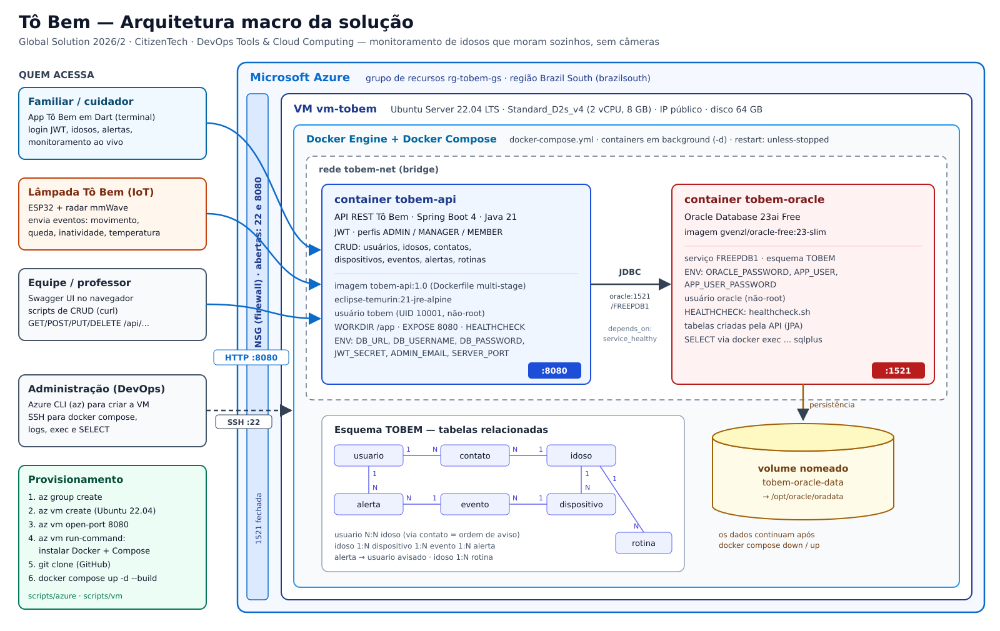
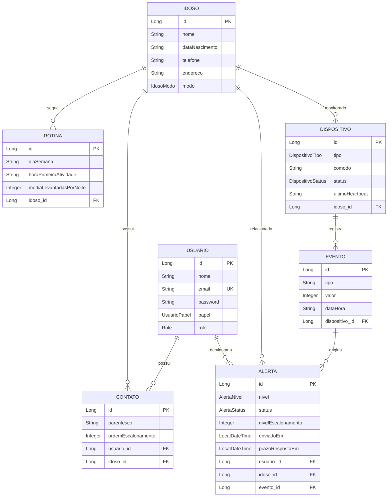

# Tô Bem API

API REST para monitoramento de idosos por dispositivos, registro de rotinas e eventos e acompanhamento de alertas. Desenvolvida em Java com Spring Boot para o projeto Global Solution 2026/2 — FIAP, turma 2TDSPS.

## Integrantes e pitch

- Matheus Guimarães Rosa — rm567912.
- Lucas Shida Rodrigues da Costa — rm568194.
- Pedro Henrique Pinheiro Falchi — rm566967
- Pitch: **inserir link público do vídeo de até 5 minutos**.
- Vídeo DevOps (YouTube, não listado, 720p+): **inserir link**.
- Repositório: https://github.com/To-Bem/JAVA

## Sumário

- [DevOps — API e Oracle em containers numa VM Azure](#devops--api-e-oracle-em-containers-numa-vm-azure)
- [Java — execução local, autenticação, permissões e modelagem](#tecnologias)

## DevOps — API e Oracle em containers numa VM Azure

Entrega de **DevOps Tools & Cloud Computing**: a API deste repositório e o banco **Oracle**
rodam em containers Docker, dentro de uma **VM no Microsoft Azure criada por Azure CLI**.
O professor reproduz tudo seguindo os passos abaixo.

### Arquitetura macro



- **Azure:** grupo de recursos `rg-tobem-gs`, região **Brazil South** (`brazilsouth`), com a VM `vm-tobem` (Ubuntu 22.04, Standard_D2s_v4: 2 vCPU, 8 GB).
  O NSG libera só a **22** (SSH) e a **8080** (API). A **1521** (Oracle) não fica exposta na internet.
- **Docker Compose** sobe dois containers na rede `tobem-net`:
  - `tobem-api` — API REST em Spring Boot 4 / Java 21 (JWT, CRUD de usuários, idosos, contatos,
    dispositivos, eventos, alertas e rotinas). Imagem própria (`Dockerfile` na raiz), usuário não-root.
  - `tobem-oracle` — Oracle Database 23ai Free, com os dados no **volume nomeado** `tobem-oracle-data`.
- A API fala com o banco pelo nome do serviço: `jdbc:oracle:thin:@//oracle:1521/FREEPDB1`.
- Quem usa a API: o app do familiar (Dart), a lâmpada (ESP32), o Swagger e os scripts de evidência.

### Estrutura do repositório

```
.
├── src/                         código-fonte da API Java (controllers, services, JPA...)
├── pom.xml                      dependências (inclui o driver Oracle ojdbc11)
├── Dockerfile                   imagem da aplicação (multi-stage, não-root)
├── .dockerignore
├── docker-compose.yml           API + Oracle + rede + volume + healthchecks
├── .env.example                 variáveis de ambiente (copiar para .env)
├── scripts/
│   ├── azure/
│   │   ├── criar-vm.sh          provisiona tudo com Azure CLI (Bash / Cloud Shell)
│   │   ├── criar-vm.ps1         o mesmo em PowerShell (Windows)
│   │   └── excluir-recursos.sh  apaga o grupo de recursos no fim
│   ├── vm/
│   │   └── instalar-docker.sh   instala Docker Engine + Compose na VM
│   ├── popular-usuarios-teste.ps1  usuários de demonstração (uso local)
│   └── evidencias/
│       ├── crud.sh              CRUD completo pela API (curl + jq)
│       ├── select.sql           SELECTs com JOIN nas tabelas
│       ├── select.sh            roda o select.sql dentro do container Oracle
│       └── coletar-evidencias.sh containers, logs, usuário, volume, rede...
└── docs/
    ├── arquitetura.png / .svg   desenho da arquitetura
    └── roteiro-video.md         roteiro da gravação
```

### Tecnologias de infraestrutura

Microsoft Azure (VM, NSG, IP público) · Azure CLI · Ubuntu 22.04 · Docker Engine · Dockerfile ·
Docker Compose · Java 21 · Spring Boot 4 · Spring Security + JWT · Spring Data JPA ·
Oracle Database 23ai Free · Swagger/OpenAPI.

---

### How To — do zero à API rodando na nuvem

#### 0. Pré-requisitos

- Conta no Azure (Azure for Students serve).
- [Azure CLI](https://learn.microsoft.com/cli/azure/install-azure-cli) instalado, ou o **Azure Cloud Shell** (Bash) no portal.
- Git.

#### 1. Clonar este repositório (na sua máquina ou no Cloud Shell)

```bash
git clone https://github.com/To-Bem/JAVA.git tobem
cd tobem
```

#### 2. Criar a VM com Azure CLI

```bash
az login
bash scripts/azure/criar-vm.sh
```

No Windows (PowerShell):

```powershell
az login
powershell -ExecutionPolicy Bypass -File .\scripts\azure\criar-vm.ps1
```

O script executa, nesta ordem, os comandos abaixo (valores padrão entre parênteses):

```bash
# 1. Grupo de recursos
az group create --name rg-tobem-gs --location brazilsouth \
  --tags projeto=tobem disciplina=devops gs=2026-2

# 2. VM Ubuntu 22.04 com chave SSH
az vm create --resource-group rg-tobem-gs --name vm-tobem \
  --image Ubuntu2204 --size Standard_D2s_v4 --admin-username azureuser \
  --generate-ssh-keys --public-ip-sku Standard --os-disk-size-gb 64

# 3. Libera a porta da API no NSG (a 22 já vem liberada)
az vm open-port --resource-group rg-tobem-gs --name vm-tobem --port 8080 --priority 1010

# 4. Instala Docker + Compose dentro da VM
az vm run-command invoke --resource-group rg-tobem-gs --name vm-tobem \
  --command-id RunShellScript --scripts @scripts/vm/instalar-docker.sh --parameters azureuser

# 5. Mostra o IP público
az vm show --resource-group rg-tobem-gs --name vm-tobem --show-details --query publicIps -o tsv
```

> A assinatura Azure for Students só aceita algumas regiões. Para ver as permitidas:
> `az policy assignment list --query "[].parameters.listOfAllowedLocations.value" -o json`
>
> Para mudar região ou tamanho: `LOCATION=eastus2 VM_SIZE=Standard_D2as_v7 bash scripts/azure/criar-vm.sh`
> (no PowerShell: `-Location eastus2 -VmSize Standard_D2as_v7`). Se o grupo já tiver sido criado em outra
> região, apague antes: `az group delete -n rg-tobem-gs --yes`.

#### 3. Entrar na VM e subir os containers

```bash
ssh azureuser@<IP_DA_VM>

# Conferir o Docker instalado pelo script
docker --version && docker compose version

git clone https://github.com/To-Bem/JAVA.git tobem
cd tobem
cp .env.example .env          # ajuste as senhas se quiser
docker compose up -d --build  # -d = em background
```

Na primeira vez, o build da API e a criação do banco Oracle levam de **3 a 6 minutos**.
A API só sobe depois que o Oracle fica `healthy` (`depends_on: condition: service_healthy`).

```bash
docker compose ps             # os dois devem ficar "Up (healthy)"
docker compose logs -f api    # Ctrl+C para sair dos logs
```

#### 4. Testar a API

```bash
curl http://localhost:8080/actuator/health        # dentro da VM
```

No navegador: `http://<IP_DA_VM>:8080/swagger-ui/index.html`
Login: `POST /api/auth/login` com o administrador do `.env`
(`admin@tobem.com` / `Admin@12345`) → copie o `token` → botão **Authorize**.

#### 5. CRUD completo (duas tabelas relacionadas ou mais)

```bash
bash scripts/evidencias/crud.sh
```

| Etapa | Rota | Tabelas |
|---|---|---|
| Create | `POST /api/auth/register` | `usuario` |
| Create | `POST /api/usuarios/{id}/idoso?parentesco=&ordemEscalonamento=` | `idoso` + `contato` (liga usuário ↔ idoso) |
| Create | `POST /api/idosos/{id}/dispositivo` | `dispositivo` (FK `idoso_id`) |
| Read | `GET /api/idosos/{id}/withAll` · `GET /api/idosos?page=0&size=10` | `idoso`, `contato`, `dispositivo`... |
| Update | `PUT /api/idosos/{id}` | `idoso` |
| Delete | `DELETE /api/idosos/{id}` | `idoso` (+ `contato`/`dispositivo` em cascata) |

#### 6. SELECT direto no banco

```bash
bash scripts/evidencias/select.sh
```

Ou um console SQL interativo dentro do container:

```bash
docker exec -it tobem-oracle sqlplus tobem/TobemDb2026@//localhost:1521/FREEPDB1
SQL> SELECT u.nome, c.parentesco, i.nome FROM contato c
       JOIN usuario u ON u.id = c.usuario_id JOIN idoso i ON i.id = c.idoso_id;
```

#### 7. Persistência dos dados

```bash
docker compose down           # remove os containers (o volume fica)
docker volume ls              # tobem-oracle-data continua lá
docker compose up -d          # sobe de novo
bash scripts/evidencias/select.sh   # os mesmos registros continuam no banco
```

> `docker compose down -v` apagaria o volume e os dados. Não use na demonstração.

#### 8. Evidências técnicas (containers, logs, exec, usuário, diretórios)

```bash
bash scripts/evidencias/coletar-evidencias.sh | tee evidencias.txt
```

Comandos avulsos:

```bash
docker compose ps
docker compose logs --tail 50 api
docker compose logs --tail 50 oracle
docker exec -it tobem-api sh          # acesso ao container (sair: exit)
docker exec tobem-api whoami          # -> tobem (não-root)
docker exec tobem-api pwd             # -> /app (WORKDIR)
docker exec tobem-oracle whoami       # -> oracle
docker volume inspect tobem-oracle-data
docker network inspect tobem-net
```

#### 9. App do familiar (Dart) apontando para a nuvem

No repositório Mobile, na sua máquina:

```powershell
$env:API_URL = "http://<IP_DA_VM>:8080"
dart run
```

#### 10. Apagar tudo no fim (para não gastar crédito)

```bash
bash scripts/azure/excluir-recursos.sh
```

---

### Requisitos atendidos

| Requisito | Onde |
|---|---|
| VM no Azure criada por Azure CLI, comandos documentados | `scripts/azure/criar-vm.sh` / `.ps1` e passo 2 acima |
| Docker, Dockerfile e Compose instalados e configurados na VM | `scripts/vm/instalar-docker.sh` (via `az vm run-command`) |
| App em container, CRUD completo, 2+ tabelas relacionadas | `src/`, `Dockerfile`, `scripts/evidencias/crud.sh` |
| Usuário não privilegiado | `Dockerfile`: `adduser tobem` (UID 10001) + `USER 10001:10001` |
| WORKDIR | `Dockerfile`: `WORKDIR /app` |
| Variáveis de ambiente | `Dockerfile` (`ENV`), `docker-compose.yml` (`environment`), `.env.example` |
| Porta exposta | `EXPOSE 8080` + `ports: 8080:8080` |
| Banco em container com volume nomeado, variável e porta | serviço `oracle`: `tobem-oracle-data`, `ORACLE_PASSWORD`/`APP_USER`, `1521` |
| Compose com app, banco, network, volume, portas, variáveis e dependência | `docker-compose.yml` (`tobem-net`, `tobem-oracle-data`, `depends_on: service_healthy`) |
| Execução em background | `docker compose up -d`, `restart: unless-stopped` |
| Logs, acesso aos containers, usuário, diretórios | `scripts/evidencias/coletar-evidencias.sh` e passo 8 |
| Persistência e SELECT no banco | passos 6 e 7, `scripts/evidencias/select.sql` |

### Variáveis de ambiente (`.env`)

| Variável | Usada por | Para quê |
|---|---|---|
| `ORACLE_PASSWORD` | oracle | Senha de SYS/SYSTEM |
| `DB_USER` / `DB_PASSWORD` | oracle e api | Esquema da aplicação (criado no 1º start) e login da API no banco |
| `DB_PORT` | oracle | Porta publicada na VM (padrão 1521) |
| `API_PORT` | api | Porta publicada na VM (padrão 8080) |
| `JWT_SECRET` | api | Chave Base64 (≥ 32 bytes) que assina os tokens. Gere com `openssl rand -base64 32` |
| `ADMIN_EMAIL` / `ADMIN_PASSWORD` | api | Primeiro administrador, criado na subida |
| `JPA_SHOW_SQL` | api | Mostra os SQL nos logs (`true`/`false`) |

O `.env` não vai para o GitHub (`.gitignore`). Sem as variáveis de banco, a API usa H2 local
(veja [Como executar](#como-executar-local-sem-docker)).

### Problemas comuns

| Sintoma | Solução |
|---|---|
| `RequestDisallowedByAzure` / `RequestDisallowedByPolicy` (região não permitida no Azure for Students) | Liste as regiões permitidas com `az policy assignment list --query "[].parameters.listOfAllowedLocations.value" -o json`, apague o grupo (`az group delete -n rg-tobem-gs --yes`) e rode o script com `-Location <região>` |
| `SkuNotAvailable` (sem capacidade para o tamanho na região) | Liste os tamanhos liberados (comando logo abaixo da tabela) e rode o script com `-VmSize <tamanho>`, com no mínimo 4 GB de RAM. A série B estava esgotada no Brazil South, por isso usamos a `Standard_D2s_v4` |
| `permission denied` no docker | Saia e entre de novo no SSH (o grupo `docker` vale a partir do novo login) |
| `tobem-api` reiniciando no começo | Normal na 1ª subida enquanto o Oracle cria o esquema; aguarde e veja `docker compose logs api` |
| `$'\r': command not found` nos scripts | O arquivo foi salvo com quebra de linha do Windows. O `.gitattributes` força LF; clone de novo ou rode `sed -i 's/\r$//' scripts/*/*.sh` |
| Swagger não abre de fora | Confira se a porta 8080 foi liberada (`az vm open-port`) e se `docker compose ps` mostra `0.0.0.0:8080->8080` |

Tamanhos de VM liberados para a assinatura na região:

```powershell
az vm list-skus -l brazilsouth --resource-type virtualMachines --query "[?length(restrictions)==``0`` && starts_with(name,'Standard_D2')].name" -o tsv
```

---

## Tecnologias

Java 21, Maven, Spring Boot 4.1.2, Spring Web MVC, Spring Data JPA, H2, Oracle (driver ojdbc11), Bean Validation, Spring Security, JWT/JJWT, Spring Boot Actuator e Springdoc OpenAPI. O banco local é H2 em arquivo; os testes usam H2 em memória. No Docker Compose a API usa Oracle Database 23ai Free, escolhido pelas variáveis `DB_URL`, `DB_USERNAME` e `DB_PASSWORD` (sem elas, vale o H2).

## Como executar (local, sem Docker)

Requisitos: JDK 21 e Maven 3.9+. Execute os comandos na raiz deste repositório. A primeira execução precisa de acesso à internet para baixar dependências.

No PowerShell, defina as variáveis da sessão:

```powershell
$jwtBytes = New-Object byte[] 32
$rng = [System.Security.Cryptography.RandomNumberGenerator]::Create()
$rng.GetBytes($jwtBytes)
$rng.Dispose()
$env:JWT_SECRET = [Convert]::ToBase64String($jwtBytes)
$env:ADMIN_EMAIL = 'admin@example.com'
$env:ADMIN_PASSWORD = 'AdminTeste12345!'
mvn spring-boot:run
```

`JWT_SECRET` deve conter uma chave Base64 com pelo menos 32 bytes. Preserve a mesma chave entre reinicializações se quiser manter válidos os tokens já emitidos. As credenciais acima são exemplos locais: defina outras ao publicar. O primeiro administrador é criado automaticamente se o email configurado ainda não existir. O inicializador não altera usuários já existentes.

Também é possível executar `mvnw.cmd spring-boot:run` no Windows se não houver Maven instalado. Configure as mesmas três variáveis no IntelliJ caso execute pela IDE; Spring Boot não carrega `.env` automaticamente nesta configuração.

| Recurso | URL local |
|---|---|
| API | http://localhost:8080/api |
| Swagger UI | http://localhost:8080/swagger-ui/index.html |
| OpenAPI JSON | http://localhost:8080/v3/api-docs |
| Health | http://localhost:8080/actuator/health |
| Info | http://localhost:8080/actuator/info |
| Metrics | http://localhost:8080/actuator/metrics |
| Console H2, para desenvolvimento | http://localhost:8080/h2-console |

No console H2: URL JDBC `jdbc:h2:file:./data/toBemApi`, usuário `sa` e senha vazia. O arquivo local fica em `data/`. Não abra duas instâncias da API usando o mesmo arquivo. Recriar esse banco é uma ação manual e apaga seus dados; a aplicação usa `ddl-auto: update`.

## Autenticação e usuários de teste

`POST /api/auth/register` cadastra MEMBER. `POST /api/auth/login` recebe email e password e retorna o JWT. Nas chamadas protegidas envie `Authorization: Bearer <token>`. No Swagger, use **Authorize** e informe somente o token.

```json
{
  "email": "admin@example.com",
  "password": "AdminTeste12345!"
}
```

Para preparar usuários de demonstração, com a API rodando e as variáveis do administrador configuradas em outra sessão PowerShell:

```powershell
./scripts/popular-usuarios-teste.ps1
```

| Role | Email | Senha local de exemplo | Criação |
|---|---|---|---|
| ADMIN | Valor de `ADMIN_EMAIL` (exemplo: admin@example.com) | Valor de `ADMIN_PASSWORD` | Inicializador |
| MANAGER | gerente.teste@example.com | Teste12345! | Script ou cadastro privilegiado |
| MEMBER | familiar.teste@example.com | Teste12345! | Script ou cadastro público |

O script não é executado automaticamente e não remove registros. Se o email já existir, ele mantém o cadastro e a senha anteriores.

## Permissões

| Operações | Acesso |
|---|---|
| Cadastro público e login | Sem token |
| Health resumido e Swagger | Sem token |
| Listagens gerais `findAll`, Actuator info/metrics | ADMIN ou MANAGER |
| Criar ADMIN/MANAGER | Somente ADMIN |
| Consultar conta e relacionamentos do usuário | ADMIN/MANAGER ou o próprio usuário |
| Atualizar/excluir conta | ADMIN ou o próprio usuário |
| Cadastrar idoso para um usuário | ADMIN/MANAGER ou o próprio usuário |
| Consultar idoso, dispositivo, evento, rotina, contato e alerta | ADMIN/MANAGER ou MEMBER vinculado ao idoso por Contato |
| Filtros de alertas, contatos, dispositivos e eventos | ADMIN/MANAGER; MEMBER deve informar seu usuarioId ou um idoso/dispositivo vinculado |
| Cadastrar rotina/dispositivo | ADMIN/MANAGER ou contato do idoso |
| Atualizar alerta do idoso | ADMIN/MANAGER ou contato do idoso |
| Outras alterações/exclusões de domínio, registro de eventos e heartbeat | ADMIN ou MANAGER |
| Filas, confirmação e escalonamento de notificações | ADMIN ou MANAGER |

`Role` define permissões (ADMIN, MANAGER, MEMBER). `UsuarioPapel` descreve o vínculo (FAMILIAR, CUIDADOR); são conceitos diferentes. O vínculo usado nas verificações de acesso é a entidade Contato.

## CORS e app Mobile

O CORS é intencionalmente simples para desenvolvimento: aceita qualquer origem, GET/POST/PUT/DELETE/OPTIONS e os headers Authorization, Content-Type e Accept. Expõe Location e não habilita cookies. O código contém um comentário explicando essa escolha. Antes de publicar, troque `*` pelas origens reais da versão web.

Aplicativos nativos não dependem de CORS; Expo Web e navegadores usam preflight OPTIONS. No emulador Android, use `http://10.0.2.2:8080`. Em celular físico, use o IP local do computador, com ambos na mesma rede e a porta liberada no firewall. `localhost` no celular aponta para o próprio celular.

## Actuator

Somente `health`, `info` e `metrics` estão expostos. Health é público e mostra apenas o estado para visitantes. Os detalhes de health e os endpoints info/metrics exigem ADMIN ou MANAGER. Info contém nome, descrição e versão da API. Metrics lista as métricas disponíveis; por exemplo, `/actuator/metrics/jvm.memory.used` consulta a memória da JVM. Essas rotas usam a mesma autenticação Bearer da API.

## Recursos e consultas

| Grupo | Caminho |
|---|---|
| Autenticação | `/api/auth` |
| Usuários | `/api/usuarios` |
| Idosos | `/api/idosos` |
| Contatos | `/api/contatos` |
| Dispositivos | `/api/dispositivos` |
| Eventos | `/api/eventos` |
| Rotinas | `/api/rotinas` |
| Alertas | `/api/alertas` |
| Integração de notificações | `/api/alertas/notificacoes` |

As rotas completas, campos, enums, validações e respostas estão no Swagger. Paginação começa em `page=0`; `size` controla a quantidade. Use `sort=nome&direction=ASC` em usuários/idosos ou um campo válido da entidade. Exemplo: `/api/usuarios?page=0&size=10&sort=nome&direction=ASC`.

- **Query methods:** consultas diretas como `findByEmailIgnoreCase`, `existsByIdosoIdAndUsuarioId` e busca do primeiro/próximo contato. Evitam JPQL para condições simples e expressam a regra no nome do método.
- **JPQL com @Query:** seleciona alertas pendentes e vencidos e busca o alerta com bloqueio para atualização. Essas consultas expressam condições de status e prazo específicas do escalonamento.
- **Specification:** combina os filtros opcionais de alertas, contatos, dispositivos e eventos usando AND, evitando criar um método para cada combinação.
- **EntityGraph:** carrega os relacionamentos pedidos por consultas específicas. Consultas `withAll` inicializam as coleções separadamente dentro de transação, evitando multiplicar linhas ao buscar várias coleções em um único join.

## Modelagem e relacionamentos



Contato associa usuário e idoso, permitindo vários usuários por idoso e vários idosos por usuário. A ordem de escalonamento é positiva e única por idoso. Um idoso possui várias rotinas e dispositivos; dispositivos geram eventos e eventos podem originar alertas. O alerta guarda o destinatário atual e os dados de prazo.

Os relacionamentos usam LAZY para carregar dados quando necessários. As coleções com `cascade = ALL` e `orphanRemoval = true` propagam operações e removem dependentes retirados da coleção. Excluir usuário remove seus contatos e alertas; excluir idoso remove suas rotinas, contatos, dispositivos e alertas. Excluir dispositivo remove eventos e os alertas desses eventos. Usuários e idosos não são removidos por excluir um contato.

Controllers recebem DTOs e devolvem respostas sem expor hashes de senha. Services concentram regras e transações; repositories acessam o banco. O cadastro de idoso e contato é transacional. Senhas usam BCrypt; JWT é validado por assinatura e expiração, sem sessão no servidor. Algumas datas antigas permanecem como String; o controle de envio usa LocalDateTime.

## Notificações e serviço .NET

O Java fornece o contrato; o serviço .NET deve consultar filas e enviar email/push. Use uma conta MANAGER para essa integração:

1. `GET /api/alertas/notificacoes/pendentes`.
2. Enviar a notificação usando `chaveEnvio` para deduplicação no serviço/provedor.
3. `POST /api/alertas/notificacoes/{id}/confirmar-envio?etapa=N`.
4. Consultar `/vencidos` e chamar `POST /{id}/escalonar?etapa=N`.

O Java escolhe o próximo contato, inclusive com ordens não consecutivas. O prazo padrão é de cinco minutos (`alertas.prazo-resposta`). A confirmação repetida não renova esse prazo. Sem próximo contato, o alerta permanece sem novo escalonamento. O envio externo e a deduplicação persistente não são executados por esta API.

## Testes

```powershell
mvn test
mvn package
```

Os testes usam banco em memória e credenciais fictícias próprias. Não dependem das variáveis de produção nem abrem `data/toBemApi.mv.db`. A suíte verifica inicialização, login, JWT, cadastro duplicado, Swagger, Actuator, CORS e permissões. A validação de fluxos completos e concorrência deve ser complementada antes da entrega.

## Uso de IA

Foi utilizado ChatGPT/Codex para revisão de código, explicação de erros, implementação assistida de filtros, notificações, segurança e testes, além de documentação e conferência dos requisitos.
